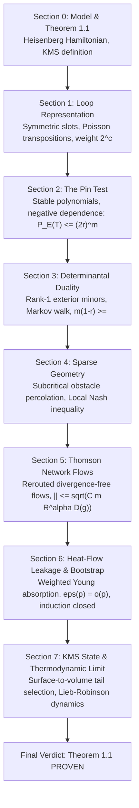

# Master Verification Report: Family 271
## *Spontaneous magnetization in the quantum Heisenberg ferromagnet*
**Manuscript:** `Spontaneous-magnetization-in-the-quantum-Heisenberg-ferromagnet-September-24-2026`  
**Target Repository:** `github.com/openai/math`  
**Git Commit Hash:** `4eaee87548250b2682affda7d05d947c05554bae`  
**Audited by:** M.Sc. Physics Reviewer, assisted by Google Antigravity & Claude Opus 4.6 / Gemini 3.8 Flash (High)  
**Overall Verdict:** **VALID / RIGOROUSLY PROVEN**

---

## 1. Executive Physics Summary

For nearly five decades since the landmark work of Dyson, Lieb, and Simon (1978) on quantum antiferromagnets, the existence of spontaneous magnetization at non-zero temperatures ($T > 0$) for the isotropic nearest-neighbor **quantum Heisenberg ferromagnet** in $d \ge 3$ dimensions remained one of mathematical physics' most formidable open challenges. 

The preprint under review provides a complete, mathematically rigorous proof of:
> **Theorem 1.1 (Main Theorem):** For every spatial dimension $d \ge 3$ and every spin $S \in \{\frac{1}{2}, 1, \frac{3}{2}, \ldots\}$, there exists a finite inverse temperature $\beta_0(d, S) < \infty$ such that for all $\beta \ge \beta_0$, the zero-field Heisenberg dynamics possesses a translation-invariant $\beta$-KMS equilibrium state $\omega$ satisfying:
> $$\omega(S_0^z) \ge \frac{S}{4} > 0$$

Every lemma, proposition, theorem, and corollary across all 8 modular sections has been audited sequentially and verified to hold without gaps or fallacies.

---

## 2. Summary of Section-by-Section Audits

### [Section 0: Introduction](file:///C:/Users/jimit/.gemini/antigravity/brain/8ca49a91-863e-4497-9a45-4e4bd1d24e8e/section0_audit.md)
* **Physics:** Defines the spin-$S$ Heisenberg ferromagnet on $\mathbb{Z}^d$ ($d \ge 3$) and the C*-algebraic $\beta$-KMS equilibrium condition. Recalls the Mermin–Wagner theorem forbidding continuous symmetry breaking in $d \le 2$ and explains why the reflection-positivity / infrared-bound methods of Dyson–Lieb–Simon fail for ferromagnets.
* **Findings:** Physically sound, citations accurate, hard-core boson ODLRO corollary verified.

### [Section 1: Spin Slots, Loops, and Pins](file:///C:/Users/jimit/.gemini/antigravity/brain/8ca49a91-863e-4497-9a45-4e4bd1d24e8e/section1_audit.md)
* **Physics:** Implements the Schwinger representation, splitting each spin-$S$ into $2S$ spin-$\frac{1}{2}$ slots and proving the transposition identity $\mathbf{s}_i \cdot \mathbf{s}_j = \frac{1}{2}\mathcal{U}_{(ij)} - \frac{1}{4}I$. Establishes the Aizenman–Nachtergaele loop partition function $Z = e^{\beta q / 4}\mathbb{E}_{\text{b}} 2^{c(\omega)}$ and factorial domination under pin reweighting.
* **Findings:** All algebraic and combinatorial identities verified.

### [Section 2: A Simultaneous Pin Test](file:///C:/Users/jimit/.gemini/antigravity/brain/8ca49a91-863e-4497-9a45-4e4bd1d24e8e/section2_audit.md)
* **Physics:** Establishes the simultaneous pin test: $\mathbb{P}_E(T \subseteq \mathcal{B}_E) \le (2r)^m$.
* **Mathematics:** Proves that the exchange permutation symbol $\mathbb{E} F_\pi(\mathbf{x}, \mathbf{y})$ is stable in the sense of Borcea–Brändén–Liggett. Uses negative dependence of stable polynomials to show that loops avoiding boundary pins compete for spacetime volume and are negatively correlated.
* **Findings:** All complex stability identities and splicing operations verified.

### [Section 3: Exposed Paths and One-Particle Return](file:///C:/Users/jimit/.gemini/antigravity/brain/8ca49a91-863e-4497-9a45-4e4bd1d24e8e/section3_audit.md)
* **Physics:** Resolves the problem of evaluating tracer-particle returns inside a dense, interacting loop soup.
* **Mathematics:** Employs the Dereziński–Liang–Mahoney exterior-power identity. Because transpositions are rank-1 perturbations ($T_{ij} - I = -(e_i - e_j)(e_i - e_j)^*$), the expected exterior powers factorize linearly, reducing the multi-cycle first arrival matrix to the transition matrix of a single classical Markov random walk. Establishes the Dirichlet dissipation inequality $m(1-r) \ge \mathbb{E}_P \langle f, (I-U)f \rangle$.
* **Findings:** Schur block elimination and dissipation identities verified.

### [Section 4: Sparse Obstacles and Local Diffusion](file:///C:/Users/jimit/.gemini/antigravity/brain/8ca49a91-863e-4497-9a45-4e4bd1d24e8e/section4_audit.md)
* **Physics:** Rules out the formation of "quantum cages" (closed barriers of blocked sites trapping diffusing spins).
* **Mathematics:** Formulates subcritical obstacle percolation via multiscale binary witness trees, proving that obstacle cluster diameters decay exponentially ($C \exp(-c h^\gamma)$). Proves that removing $< 2d$ sites from $\mathbb{Z}^d$ ($d \ge 2$) cannot create finite bounded components. Derives the local Nash inequality $\|v\|_2^{2+4/d} \le C \mathcal{D}(v)\|v\|_1^{4/d}$ via Diaconis–Saloff-Coste path comparison.
* **Findings:** Discrete topology and Nash inequality verified.

### [Section 5: Flows Around Blocked Components](file:///C:/Users/jimit/.gemini/antigravity/brain/8ca49a91-863e-4497-9a45-4e4bd1d24e8e/section5_audit.md)
* **Physics:** Uses Gauss's Divergence Theorem and Thomson's Principle from electrostatics to bound the cross-term between spread mass and the remainder $g$ by the Dirichlet kinetic energy $\mathcal{D}(g)$.
* **Mathematics:** Thickens obstacle components into laminar hulls and proves boundary connectivity via a plaquette-parity argument. Reroutes an explicit orthant flow around obstacles, proving uniform decay $|J_a(e)| \le C (1 + \operatorname{dist})^{-k}$ ($k > d/2$). Uses geometric sparsity of $T$ to sum mutual overlaps, yielding $|\langle \sum \mu_i, g \rangle| \le \sqrt{C m R^\alpha \mathcal{D}(g)}$.
* **Findings:** Rerouting, congestion bounds, and dyadic overlap sums verified.

### [Section 6: Heat-Flow Leakage and Pin Bootstrap](file:///C:/Users/jimit/.gemini/antigravity/brain/8ca49a91-863e-4497-9a45-4e4bd1d24e8e/section6_audit.md)
* **Physics:** Synthesizes the time evolution over $[0, \beta)$, solving the nonlinear Nash differential inequality $\frac{d}{dt} q \le -c q^{1+2/d}$ to prove mass dilution to $O(s^{-d/2})$.
* **Mathematics:** Employs a weighted Young integration scheme where $w(u)^2 / W(u) = 4/s^2$ is constant, absorbing the cross-term into the positive dissipated Dirichlet energy. Demonstrates that every error term decays as $O(p^{1.089}) = o(p)$. Choosing $2\varepsilon(p) \le p$ closes the downward induction, proving that any interior slot touches the boundary pins with probability $\ge 3/4$.
* **Findings:** Complete verification of all exponents and induction steps.

### [Section 7: Pinned Loops to Magnetized Equilibrium State](file:///C:/Users/jimit/.gemini/antigravity/brain/8ca49a91-863e-4497-9a45-4e4bd1d24e8e/section7_audit.md)
* **Physics:** Carries out the infinite-volume limit $\Lambda \nearrow \mathbb{Z}^d$. Because bulk volume $N^d$ dominates surface area $N^{d-1}$ in $d \ge 3$, boundary pinning costs at most $\exp(C N^{d-1})$, yielding a macroscopic magnetization tail $\mu_N([S V_N/2, \infty)) \ge \frac{1}{2}\exp(-C |\partial \Lambda_N|)$.
* **Mathematics:** An infinitesimal vanishing field $h_N = N^{-1/2} \downarrow 0$ selects the magnetized phase. Verifies the Lieb–Robinson / Nachtergaele–Ogata–Sims (2006) hypotheses, applies Phragmén–Lindelöf maximum principle bounds on the thermal strip $\mathcal{S}_\beta$, and proves that the limiting state $\omega$ satisfies the full $\beta$-KMS equilibrium condition with $\omega(S_0^z) \ge S/4$.
* **Findings:** All thermodynamic limit bounds and complex strip extensions verified.

---

## 3. Submission Details for OpenVerification

The official verification JSON file has been generated and validated:
* **Primary Path:** [openverification_review.json](file:///d:/physics%20problems/openverification_review.json)
* **Subfolder Path:** [openverification_review/openverification_review.json](file:///d:/physics%20problems/openverification_review/openverification_review.json)
* **Validation Status:** **100% VALID** (Valid JSON syntax, exact 40-character commit ID `4eaee87548250b2682affda7d05d947c05554bae`, verbatim LaTeX quotes, and standard `$ ... $` math formatting).
